# Unidad 4 – Actividad 01: RESTCONF con Postman

- **Alumno:** Omar Manuel Amador Espinoza
- **No. de control:** 1225100271
- **No. de lista:** 3
- **Grupo:** GTIR246
- **Fecha:** 10 de noviembre de 2026
- **Rama de entrega:** `feat/unidad4_act01`

---

## 1. Objetivo

Interactuar con la interfaz **RESTCONF** de un router Cisco IOS XE para consultar su configuración (JSON y XML), crear, modificar y eliminar una interfaz Loopback, y provocar errores HTTP para interpretarlos.

## 2. Entorno utilizado

| Elemento | Detalle |
|---|---|
| Dispositivo | Cisco Catalyst 8000V (IOS XE 17.12) en el DevNet Sandbox |
| IP de gestión | `10.10.20.48` (interfaz GigabitEthernet1) |
| Acceso | VPN del sandbox con **OpenConnect** dentro de Ubuntu (WSL) |
| Credenciales RESTCONF | `developer` / `C1sco12345` (credenciales públicas del sandbox) |
| Cliente HTTP | `curl` desde Ubuntu (WSL) |
| Editor | Visual Studio Code |
| Interfaz asignada | `Loopback3` (IP `3.3.3.3/24`) |


### Nota sobre Postman

La práctica indica Postman, pero la VPN del sandbox solo pudo establecerse con OpenConnect **dentro de Ubuntu (WSL)**, por lo que el túnel no existe en Windows y Postman no alcanza el router. Para cumplir el mismo objetivo se usó `curl`, que permite enviar exactamente lo mismo que Postman:

| En Postman | Equivalente en `curl` |
|---|---|
| SSL certificate verification: OFF | `-k` |
| Authorization: Basic Auth | `-u developer:C1sco12345` |
| Header `Accept` | `-H "Accept: application/yang-data+json"` |
| Header `Content-Type` | `-H "Content-Type: application/yang-data+json"` |
| Método (GET, PUT, PATCH, DELETE, POST) | `-X MÉTODO` |
| Body → raw → JSON | `-d '{...}'` |
| Ver código de estado | `-i` (muestra los encabezados de respuesta) |

## 3. Estructura del repositorio

```
.
├── README.md
├── capturas/      ← capturas de pantalla de cada paso
├── salidas/       ← respuestas completas del router (JSON/XML)
└── evidencias/    ← documento de evidencias (DESAFIO_2.docx)
```

---

## 4. Práctica guiada

### Parte 1 – Autenticación y encabezados

- SSL deshabilitado (`-k`), Basic Auth con `developer` y encabezados `Accept` / `Content-Type`.
- GET a `/restconf/data/Cisco-IOS-XE-native:native` con respuesta **200 OK**.

### Parte 2 – Consulta de interfaces

```bash
# Todas las interfaces (modelo ietf-interfaces)
curl -k -i -u developer:C1sco12345 -H "Accept: application/yang-data+json" \
  https://10.10.20.48/restconf/data/ietf-interfaces:interfaces

# Datos operativos y estadísticas
curl -k -i -u developer:C1sco12345 -H "Accept: application/yang-data+json" \
  https://10.10.20.48/restconf/data/ietf-interfaces:interfaces-state
```

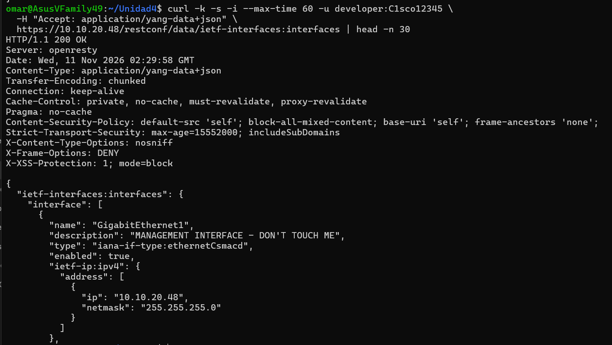
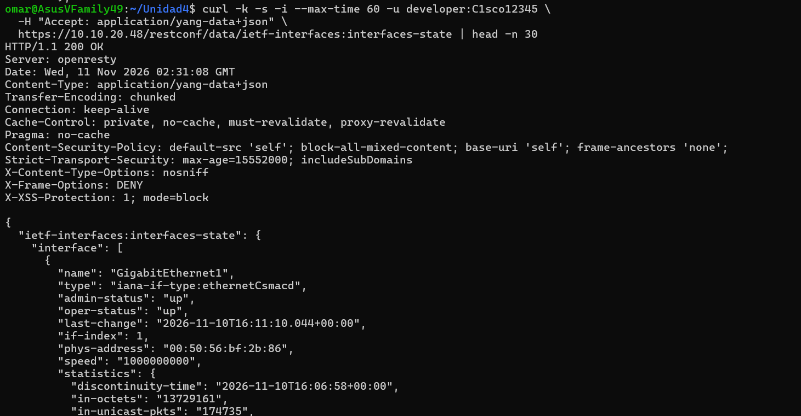

**Pregunta: ¿Cuál es la nueva URL para obtener datos operativos?**
`https://10.10.20.48/restconf/data/ietf-interfaces:interfaces-state`, el contenedor del modelo `ietf-interfaces` que incluye `admin-status`, `oper-status` y las estadísticas (`in-octets`, `out-octets`, `in-errors`, etc.).

### Parte 3 – Crear y eliminar una interfaz

Creación con **PUT** (201 Created) y eliminación con **DELETE** (204 No Content): ver Desafíos 3 y 5.

**Pregunta: ¿Qué cambios fueron necesarios en la petición para eliminar la interfaz?**
Solo cambiar el método HTTP de **PUT a DELETE**, conservando la misma URL del recurso (`.../interfaces/interface=Loopback3`) y **sin body**.

---

## 5. Desafíos

### Desafío 1 – Configuración global en JSON y XML

Mismo GET; **solo cambia el encabezado `Accept`**.

```bash
# JSON
curl -k -i -u developer:C1sco12345 -H "Accept: application/yang-data+json" \
  https://10.10.20.48/restconf/data/Cisco-IOS-XE-native:native -o salidas/native.json

# XML
curl -k -i -u developer:C1sco12345 -H "Accept: application/yang-data+xml" \
  https://10.10.20.48/restconf/data/Cisco-IOS-XE-native:native -o salidas/native.xml
```

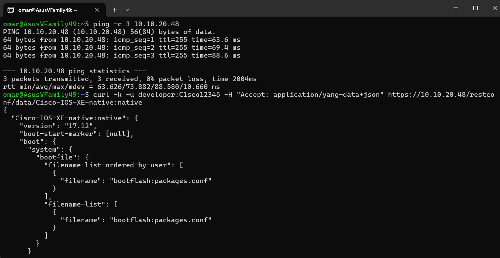
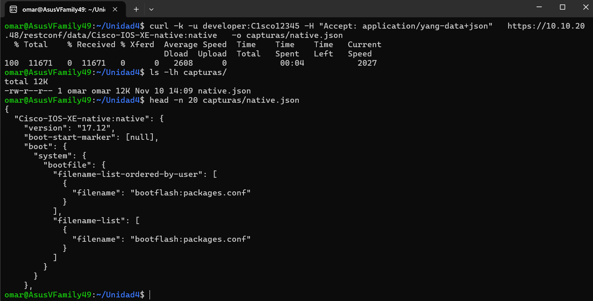
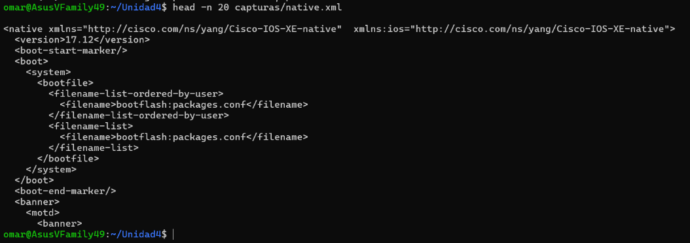
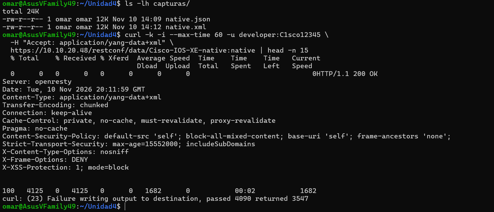

Archivos completos: [`salidas/native.json`](salidas/native.json) y [`salidas/native.xml`](salidas/native.xml).

### Desafío 2 – Solo la interfaz GigabitEthernet1 (JSON)

```bash
curl -k -i -u developer:C1sco12345 -H "Accept: application/yang-data+json" \
  https://10.10.20.48/restconf/data/ietf-interfaces:interfaces/interface=GigabitEthernet1
```

Resultado: **200 OK**, con la interfaz de gestión `10.10.20.48/24`.

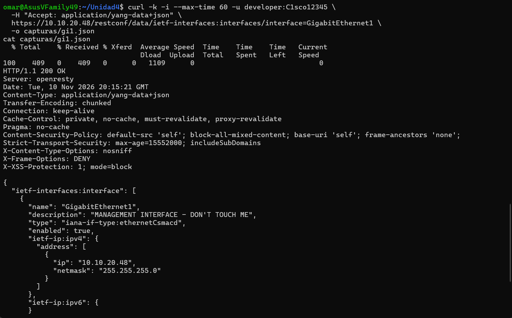

### Desafío 3 – Crear `Loopback3` (PUT → 201 Created)

```bash
curl -k -i -X PUT -u developer:C1sco12345 \
  -H "Content-Type: application/yang-data+json" \
  -H "Accept: application/yang-data+json" \
  https://10.10.20.48/restconf/data/ietf-interfaces:interfaces/interface=Loopback3 \
  -d '{
    "ietf-interfaces:interface": {
      "name": "Loopback3",
      "description": "Interfaz creada por OMAR AMADOR",
      "type": "iana-if-type:softwareLoopback",
      "enabled": true,
      "ietf-ip:ipv4": {
        "address": [{"ip": "3.3.3.3", "netmask": "255.255.255.0"}]
      }
    }
  }'
```

Resultado: **`HTTP/1.1 201 Created`**, con el encabezado `Location` apuntando a la nueva interfaz.

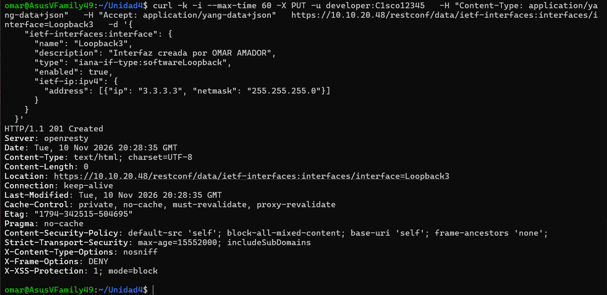

Verificación con GET (interfaz creada, `enabled: true`):

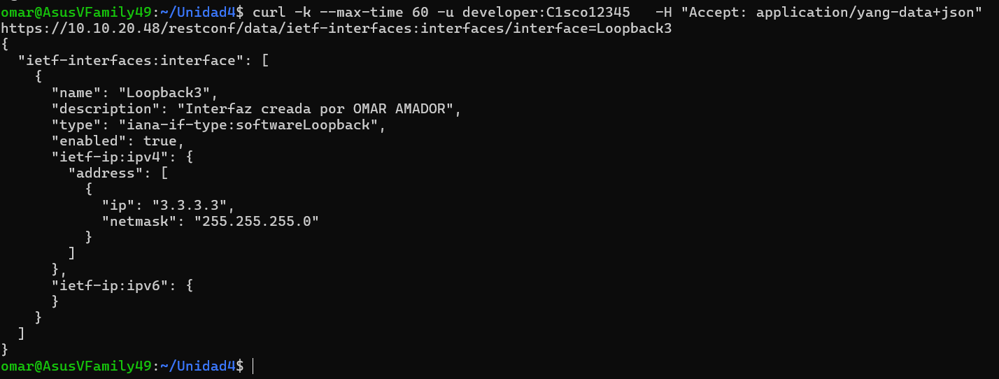

### Desafío 4 – Modificar con PATCH (deshabilitar la interfaz)

```bash
curl -k -i -X PATCH -u developer:C1sco12345 \
  -H "Content-Type: application/yang-data+json" \
  https://10.10.20.48/restconf/data/ietf-interfaces:interfaces/interface=Loopback3 \
  -d '{"ietf-interfaces:interface": {"name": "Loopback3", "enabled": false}}'
```

Resultado: **`204 No Content`**. Con un GET posterior se confirma `"enabled": false`; la descripción y la IP no cambiaron, porque PATCH modifica solo los campos enviados.

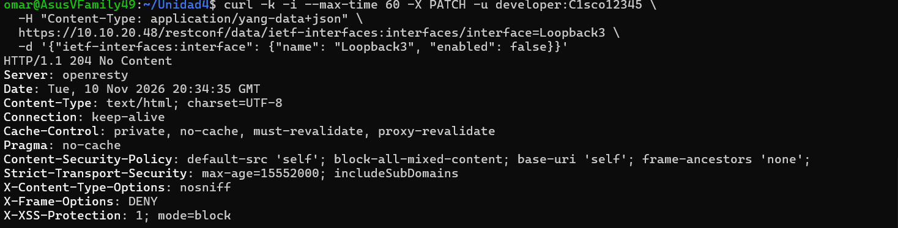
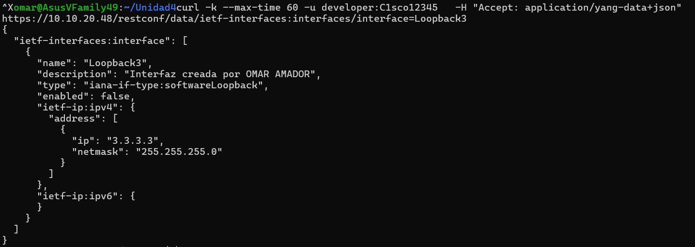

### Desafío 5 – Eliminar con DELETE

```bash
curl -k -i -X DELETE -u developer:C1sco12345 \
  https://10.10.20.48/restconf/data/ietf-interfaces:interfaces/interface=Loopback3
```

Resultado: **`204 No Content`**. Al repetir el GET, el router responde **404 Not Found** (`uri keypath not found`), lo que confirma que la interfaz ya no existe.

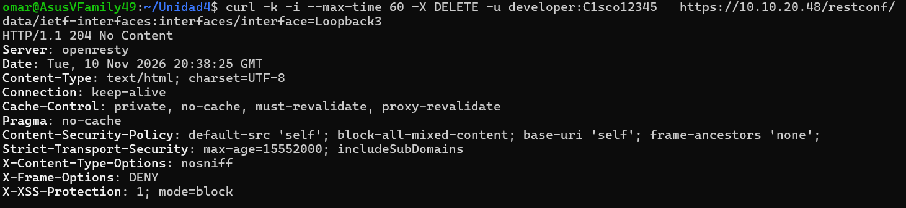
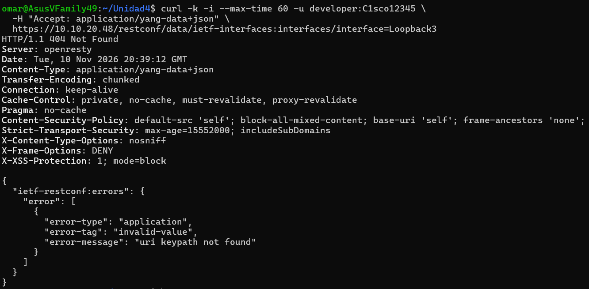

---

## 6. Pruebas de error

| Prueba | Cómo se provocó | Resultado | Captura |
|---|---|---|---|
| Credenciales incorrectas | Basic Auth `developer` / `Cisco123` | **401 Unauthorized** (`access-denied`) | 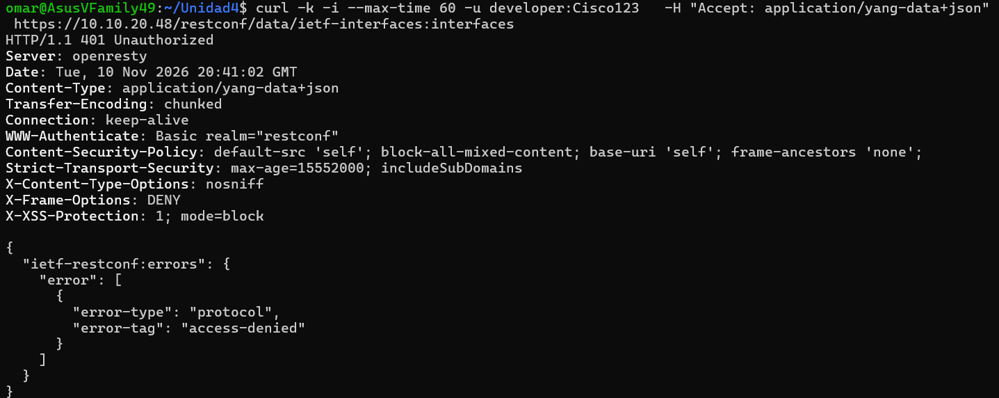 |
| URL mal escrita | `.../ietf-interfaces:interfases` | **404 Not Found** (`uri keypath not found`) | 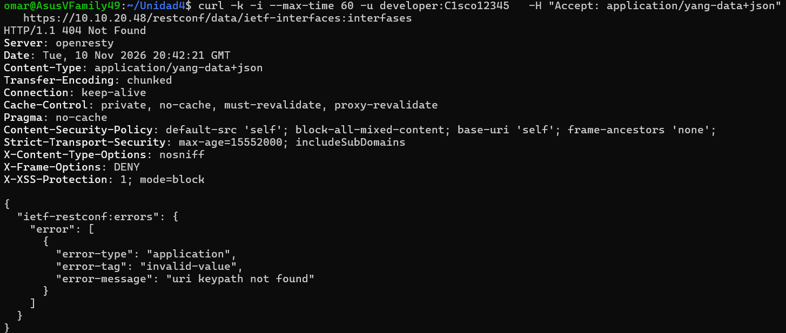 |
| JSON mal formado | POST con la llave de cierre omitida | **400 Bad Request** (`malformed-message`, *Premature end of file*) | 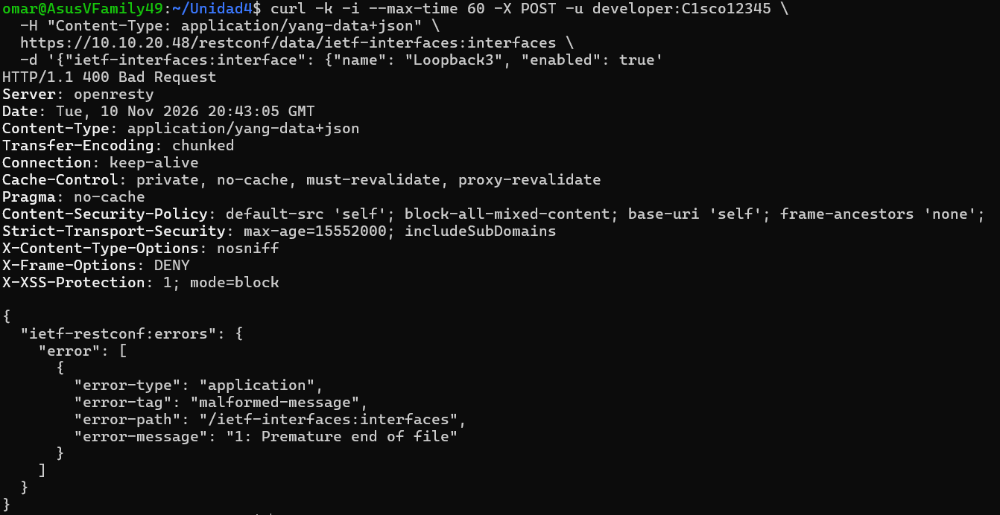 |

**Interpretación:**
- **401**: el servidor no pudo autenticar al cliente; el problema está en usuario/contraseña.
- **404**: el servidor no encontró el recurso; la URL o el nombre del recurso es incorrecto.
- **400**: el servidor recibió un cuerpo con sintaxis inválida y no pudo interpretarlo.

---

## 7. Preguntas de reflexión

**1. ¿Qué encabezado HTTP indica al servidor en qué formato queremos recibir la información?**
El encabezado **`Accept`**. Con `application/yang-data+json` se recibe JSON y con `application/yang-data+xml` se recibe XML (por defecto). El encabezado `Content-Type`, en cambio, indica el formato del cuerpo que **nosotros enviamos**.

**2. ¿Qué código de estado devuelve el router tras eliminar exitosamente la interfaz?**
**`204 No Content`**: la operación se realizó correctamente y no hay contenido que devolver.

**3. Diferencia entre JSON y XML en la respuesta.**
Es la misma información del modelo YANG con distinta codificación. JSON usa llaves y pares clave-valor (`"version": "17.12"`), mientras que XML usa etiquetas anidadas (`<version>17.12</version>`). Para cambiar entre uno y otro solo se modifica el encabezado `Accept`.

**4. Diferencia práctica entre los métodos HTTP utilizados.**

| Método | Función | Ejemplo en esta práctica |
|---|---|---|
| **GET** | Leer datos sin modificar nada | Consultar `native`, `interfaces`, `interfaces-state` |
| **POST** | Crear un recurso dentro de un contenedor existente | Prueba de error 400 sobre `ietf-interfaces:interfaces` |
| **PUT** | Crear o **reemplazar** completamente un recurso | Crear `Loopback3` (201) |
| **PATCH** | Modificar **parcialmente** un recurso | Cambiar solo `enabled` a `false` (204) |
| **DELETE** | Eliminar un recurso | Borrar `Loopback3` (204) |

**5. Significado de los códigos de estado obtenidos.**

| Código | Significado | Dónde apareció |
|---|---|---|
| **200 OK** | Petición exitosa con datos en la respuesta | Todos los GET |
| **201 Created** | El recurso se creó | PUT de `Loopback3` |
| **204 No Content** | Éxito sin cuerpo de respuesta | PATCH y DELETE |
| **400 Bad Request** | Cuerpo mal formado | JSON sin cerrar |
| **401 Unauthorized** | Autenticación fallida | Contraseña incorrecta |
| **404 Not Found** | Recurso o URL inexistente | URL mal escrita y GET tras DELETE |

---

## 8. Seguridad

- Las credenciales `developer / C1sco12345` son las públicas del DevNet Sandbox.
- **No** se incluyen en este repositorio las credenciales de la VPN.
- Solo se modificó `Loopback3`, la interfaz asignada. No se tocó `GigabitEthernet1` (interfaz de gestión) ni las demás interfaces del sandbox.
